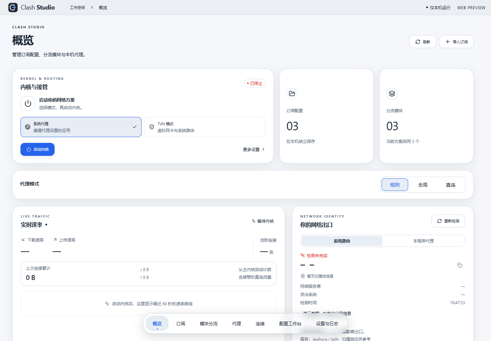
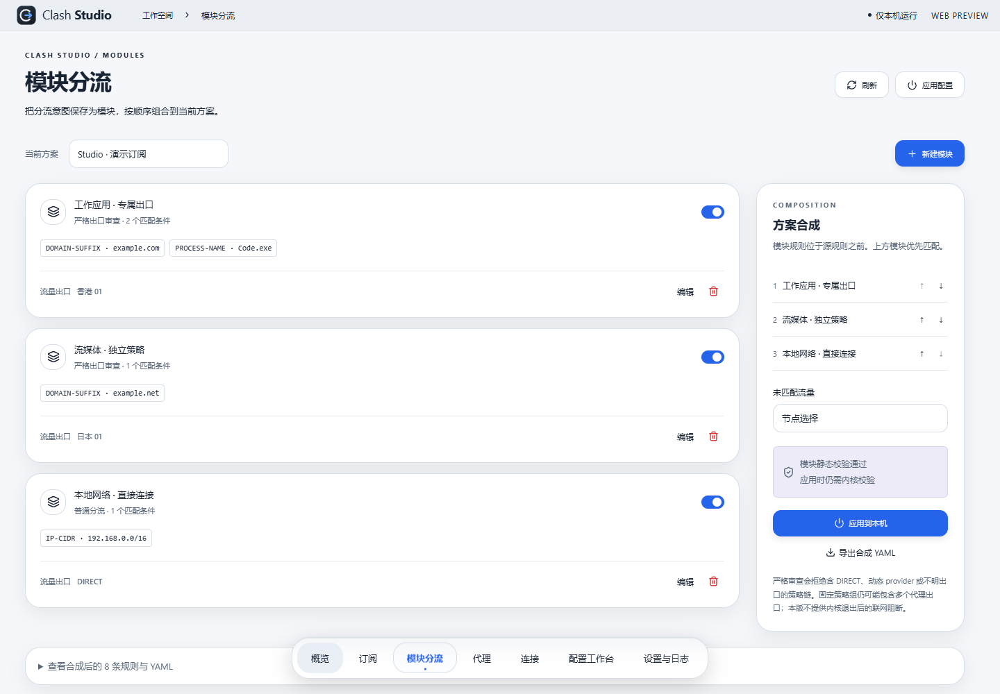
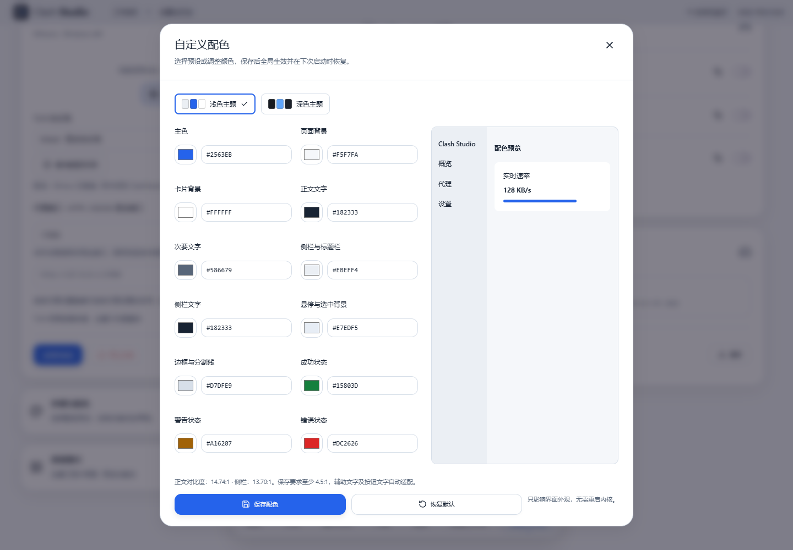
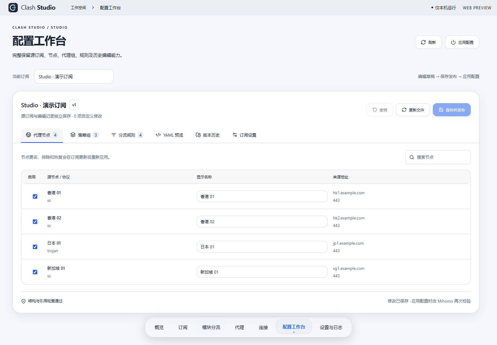

<h1 align="center">Clash Studio</h1>

Precise routing. Thoughtful desktop design.

<a href="https://github.com/zheng0625/Clash-Studio/releases/tag/v1.0">Download for Windows / Linux / Android</a> · <a href="README.md">简体中文</a> · <a href="LICENSE">GPL-3.0</a>

**Clash Studio is a Windows / Linux Mihomo desktop client focused on visual subscription editing, reusable routing modules and precise routing, with a customizable desktop interface.**

It connects source subscriptions, personal edits, routing modules and runtime configuration. Organize nodes, groups and rules, then route domains, application processes and IP subnets through selected groups and exits.

## Precise routing comes first

- Match domains, domain suffixes, process names, process paths, and IPv4 / IPv6 subnets.
- Assign each module a group or exit; reuse, enable and order modules across subscription plans. Module rules precede source subscription rules.
- Inspect visible nested exit chains in strict mode, rejecting reachable DIRECT exits, missing or cyclic references, and dynamic members that cannot be fully inspected.
- Check actual Mihomo rule matches, chains and traffic in the connection view.

Precision applies to traffic captured by the core with identifiable matching conditions. Coverage depends on system proxy / TUN, process recognition and network conditions. Strict checks do not guarantee a fixed public IP. There is currently no firewall kill switch after the core exits.

## A considered desktop interface

- Liquid Glass inspired layers, rounded cards and a floating Dock organize the workspace.
- Light / dark themes, custom colors and full-window photo backgrounds, with cropping and previews.
- Dedicated appearance dialogs and horizontally centered notifications above the Dock.
- Immediate node feedback, coalesced rapid clicks and less repeated rendering. Select manual nodes before starting the main core.
- Simplified Chinese / English, system language following, lazy page loading and parallel desktop / backend startup.

## Edit subscriptions and keep your changes

Built on [Clash Subscription Studio](https://github.com/zheng0625/clash-subscription-studio), the editor separates source configuration from persistent user edits. Import URL / YAML subscriptions, edit nodes, groups and rules, refresh while replaying edits, review conflicts, preview YAML, publish and restore history.

The workflow is draft → preview → save and publish → apply to the core. Manual node choices are stored per subscription and restored on the next start. Automatic groups retain automatic routing.

## Desktop features

Windows supports system proxy and TUN with an on-demand administrator helper. Linux supports GNOME system proxy and TUN with graphical authorization for the bundled core. Both include tray integration, desktop startup preferences, HTTP delay testing, traffic and connections, LAN proxy settings, IPv6, DNS overrides and GeoData updates. Login startup launches the application without automatically starting a subscription core.

## Download 1.0

| Package | Download | Application data |
| --- | --- | --- |
| Windows x64 portable | [ZIP](https://github.com/zheng0625/Clash-Studio/releases/download/v1.0/ClashStudio-1.0-portable-windows-x64.zip) | Adjacent `data/` |
| Windows x64 installer | [EXE](https://github.com/zheng0625/Clash-Studio/releases/download/v1.0/ClashStudio-1.0-setup-windows-x64.exe) | `%LOCALAPPDATA%\ClashStudio` |
| Android arm64-v8a | [APK](https://github.com/zheng0625/Clash-Studio/releases/download/v1.0/ClashStudio-1.0-android-arm64-v8a.apk) | App private storage; export settings and uninstall the old debug build first |
| Linux x64 | [tar.gz](https://github.com/zheng0625/Clash-Studio/releases/download/v1.0/ClashStudio-1.0-linux-x64.tar.gz) | Adjacent `data/`, or `--data-dir` |

Extract the entire Windows ZIP and run `ClashStudio.exe`, or use the installer. On Linux, extract and run `./Start.sh`. The Linux package uses an Ubuntu 22.04 x64 baseline . See the [Linux guide](docs/linux-preview.md).

Python, Mihomo v1.19.33 and four base databases are bundled; Windows also includes Wintun. Windows requires system WebView2; Linux requires desktop GTK / WebKit libraries. No development tools are required. Remote providers / rule sets referenced by subscriptions still need network access. No proxy service or usable subscription is provided.

Version 1.0 includes Windows, Linux and Android packages. Automated checks and their scope are in [validation notes](docs/validation-1.0.md). Validation on these devices does not cover every system and network. Windows packages are unsigned. Exit the old version and back up data before upgrading; portable and installed data locations differ.

## Source and license

Tauri 2 / Rust + Vue 3 / TypeScript / Vite + Python local configuration service + Mihomo. See [BUILDING.md](BUILDING.md). Releases include corresponding application source, upstream Mihomo source and SHA-256 checksums. Personal data, subscriptions, binary cores and local toolchains are excluded from the repository.

Project code: **GPL-3.0-only**, see [LICENSE](LICENSE). Dependencies and datasets retain their respective licenses; see [THIRD_PARTY_NOTICES.md](THIRD_PARTY_NOTICES.md). Software is provided without warranty. This independent community project is not an official release of Tauri, Clash, Mihomo or Clash Verge Rev.

Thanks to Clash Subscription Studio, Tauri, Clash / Dreamacro and contributors, Mihomo / MetaCubeX, Clash Verge Rev, Vue, Vite, Lucide, Python, FastAPI, WireGuard / Wintun, meta-rules-dat, Loyalsoldier, v2fly, MaxMind and other upstream contributors.

See the [project statement](docs/project-statement.md) for scope, upstream attribution, privacy and platform limits.
